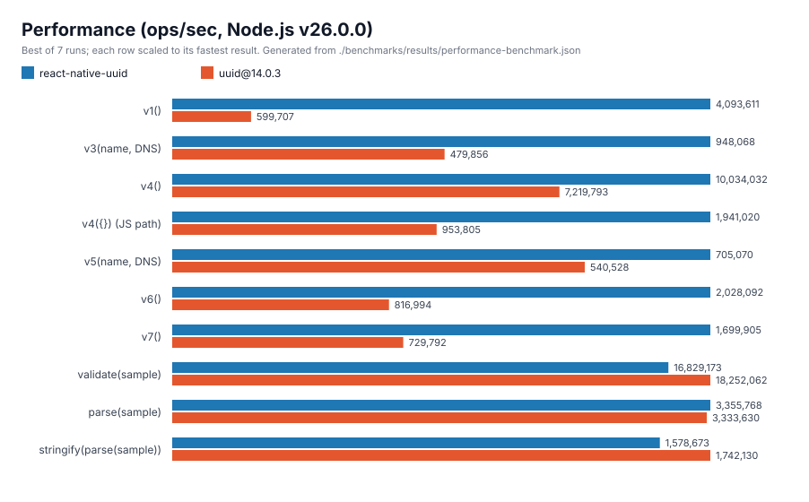
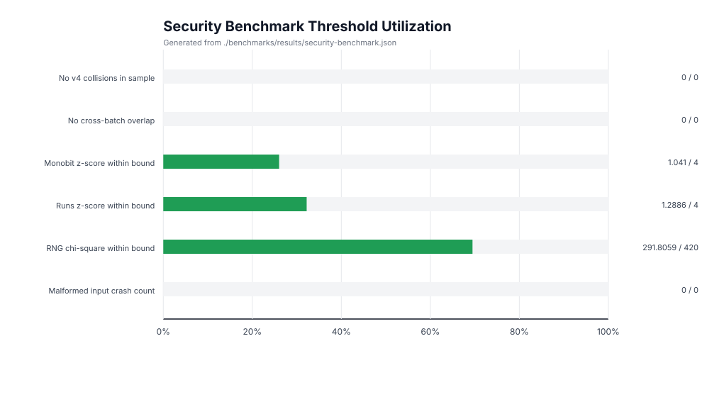

# react-native-uuid

[](./LICENSE)
[](https://www.npmjs.com/package/react-native-uuid)
[](https://npmcharts.com/compare/react-native-uuid?minimal=true)
[](https://npmcharts.com/compare/react-native-uuid?minimal=true)
[](https://github.com/eugenehp/react-native-uuid/watchers)
[](https://github.com/eugenehp/react-native-uuid/stargazers)
[](https://github.com/eugenehp/react-native-uuid/network/members)
[](https://github.com/eugenehp/react-native-uuid/issues?utf8=%E2%9C%93&q=is%3Aissue+is%3Aopen+label%3Abug)
[](https://github.com/eugenehp/react-native-uuid/issues)
[](https://github.com/eugenehp/react-native-uuid/pulls)

[](https://packagephobia.com/result?p=react-native-uuid)
[](https://bundlephobia.com/result?p=react-native-uuid)
[](https://github.com/eugenehp/react-native-uuid/actions/workflows/ci.yml)
[](https://nodejs.org/en/)
[](https://www.typescriptlang.org/)

`react-native-uuid` is a zero-dependency TypeScript implementation of [RFC 9562](https://www.rfc-editor.org/rfc/rfc9562) (which obsoletes [RFC 4122](https://www.rfc-editor.org/rfc/rfc4122)) **Universally Unique IDentifiers**, with an API compatible with the [`uuid`](https://github.com/uuidjs/uuid) package. It supports UUID versions 1, 3, 4, 5, 6 and 7, and works in React Native, browsers and Node.js.

**Heavily inspired by:**

- [uuid](https://github.com/uuidjs/uuid)
- [pure-uuid](https://github.com/rse/pure-uuid)
- [nanoid](https://www.npmjs.com/package/nanoid)

Huge thanks to [Randy Coulman](https://github.com/randycoulman) for the early version of a code.

## Getting started

### Requirements

- **Node.js**: 22.0.0 or higher (for Node.js usage and development)
- **npm**: 10.0.0 or higher
- **React Native**: 0.74 or higher (optional peer dependency; not needed for Node.js or browsers)

### Installation

```shell
npm install react-native-uuid
cd ios && pod install # React Native iOS only
```

The package includes a small native module (iOS and Android) that provides secure random bytes. It is autolinked, so a native rebuild is all that is needed. In environments without it (Expo Go, web) the library uses `crypto.getRandomValues` or falls back as described in [Random values](#random-values).

### Usage

```javascript
import uuid from 'react-native-uuid';
// Or import only what you need:
import {v4, v7, validate} from 'react-native-uuid';

uuid.v4(); // ⇨ '11edc52b-2918-4d71-9058-f7285e29d894'
uuid.v7(); // ⇨ '01a1dcb5-96f0-76d7-b0f0-515332ecb719' (sorts by creation time)
uuid.v5('www.example.com', uuid.DNS); // ⇨ '2ed6657d-e927-568b-95e1-2665a8aea6a2'
```

| Function                                  | Description                                                              |
| ----------------------------------------- | ------------------------------------------------------------------------ |
| `v1()`                                    | Time-based UUID                                                          |
| `v3(name, namespace)`                     | Name-based UUID (MD5)                                                    |
| `v4()`                                    | Random UUID                                                              |
| `v5(name, namespace)`                     | Name-based UUID (SHA-1)                                                  |
| `v6()`                                    | Time-based UUID, field-reordered so it sorts by time                     |
| `v7()`                                    | Unix-epoch time-based UUID; sorts by time, good for database keys        |
| `v1ToV6(uuid)` / `v6ToV1(uuid)`           | Convert between v1 and v6                                                |
| `parse(uuid)` / `stringify(bytes)`        | Convert between string and bytes (both validate)                         |
| `unparse(bytes)`                          | Convert bytes to a string without validating                             |
| `validate(uuid)` / `version(uuid)`        | Check a UUID string / get its version                                    |
| `NIL`, `MAX`, `DNS`, `URL`, `OID`, `X500` | Special UUIDs and standard namespaces                                    |
| `randomSource()`                          | Which random source is in use: `'crypto'`, `'native'` or `'Math.random'` |

Generators accept an optional `buf` (array or `Uint8Array`) and `offset` to write the 16 bytes instead of returning a string. See the [API documentation](./docs/modules.md) for all options.

### Random values

`v1`, `v4`, `v6` and `v7` need random bytes. The library uses, in order:

1. `crypto.getRandomValues` when available: browsers, Node.js, and React Native with a polyfill such as [`react-native-get-random-values`](https://github.com/LinusU/react-native-get-random-values).
2. The bundled native module on React Native: `SecRandomCopyBytes` on iOS, `SecureRandom` on Android.
3. `Math.random`, which is **not** cryptographically secure. This only happens when neither of the above is available, e.g. in Expo Go without a polyfill.

Call `uuid.randomSource()` to check which one your app is using.

### Migrating from 2.x

- **`v3()` and `v5()` return different values.** 2.x produced non-standard UUIDs ([#52](https://github.com/eugenehp/react-native-uuid/issues/52)); 3.x matches RFC 9562, the `uuid` package and Python. Re-generate any stored v3/v5 UUIDs, or keep 2.x for reading old ones.
- **`parse()` throws `TypeError('Invalid UUID')`** for invalid input instead of returning zero-filled bytes. Call `validate()` first if input may be invalid. `v3()`/`v5()` also throw for an invalid namespace string.
- **Deep imports are no longer supported** (e.g. `react-native-uuid/dist/v4`). Import from `react-native-uuid` instead.
- **`validate()` accepts versions 6-8 and the max UUID** (`ffffffff-ffff-ffff-ffff-ffffffffffff`).
- **Node.js 22+** is required.
- **React Native:** run `pod install` and rebuild the app to link the native random module.

## Development

### Available Scripts

```bash
# Install dependencies
npm install

# Run tests
npm test
npm test -- --watch          # Watch mode
npm test -- --coverage       # With coverage report

# Linting and formatting
npm run lint                  # Type-check and lint
npm run prettier:write        # Format all files
npm run prettier:check        # Check formatting without changes

# Building
npm run build                 # Build CommonJS (dist/cjs) and ES modules (dist/esm)
npm run check:package         # Build and validate package exports and types
npm run size                  # Check bundle size limits (.size-limit.json)

# Benchmarking
npm run bench:perf            # Performance benchmark vs the uuid package
npm run bench:security        # Run security benchmark with pass/fail thresholds

# Documentation
npm run docs                  # Generate TypeDoc documentation
```

## Benchmarking

`npm run bench:perf` measures operations per second for each function in Node.js, next to the [`uuid`](https://github.com/uuidjs/uuid) package in the same process (best of 7 interleaved runs). Results depend on the machine, so compare the ratios rather than absolute numbers; Hermes on a device is slower in absolute terms.

- Cases: `v1`, `v3`, `v4`, `v5`, `v6`, `v7`, `validate`, `parse`, `stringify`
- Stored results: [`benchmarks/results/performance-benchmark.md`](./benchmarks/results/performance-benchmark.md) (data: `performance-benchmark.json`)
- Stored test report: `benchmarks/results/test-results.json`

Generate fresh results locally:

```bash
npm run build
npm run bench:perf
npm test -- --runInBand --json --outputFile benchmarks/results/test-results.json
npm run bench:security
npm run bench:figures
```

### Charts





## Security Benchmarking

The security benchmark is designed as a pass/fail gate for randomness quality and misuse safety checks.

- Command: `npm run bench:security`
- Stored report: `benchmarks/results/security-benchmark.md`
- Stored data: `benchmarks/results/security-benchmark.json`
- CI workflow: `.github/workflows/security-benchmark.yml`

Current threshold gates:

- v4 sample collisions: `0`
- Cross-batch overlap (restart proxy): `0`
- Monobit test z-score: `<= 4`
- Runs test z-score: `<= 4`
- RNG chi-square score (256 bins): `<= 420`
- Malformed input crashes: `0`

The CI job fails if any threshold is exceeded.

## Documentation

API documentation is available [here](./docs/modules.md). Regenerate it with `npm run docs`.

## Troubleshooting

- **`uuid.randomSource()` returns `'Math.random'` on React Native**: rebuild the app after installing (`cd ios && pod install`) so the native module is linked. Expo Go can't load custom native modules; use a development build or install `react-native-get-random-values`.
- **Upgrading from 2.x**: see [Migrating from 2.x](#migrating-from-2x).

Please submit an [issue](https://github.com/eugenehp/react-native-uuid/issues) if you found a bug.

## Contributing

See the [contributing guide](CONTRIBUTING.md) to learn how to contribute to the repository and the development workflow.

## Sponsorship

Thank you to our sponsors:

[](https://www.reactivelions.com)

## License

[MIT](./LICENSE)

Copyright (c) 2016-2026 Eugene Hauptmann
